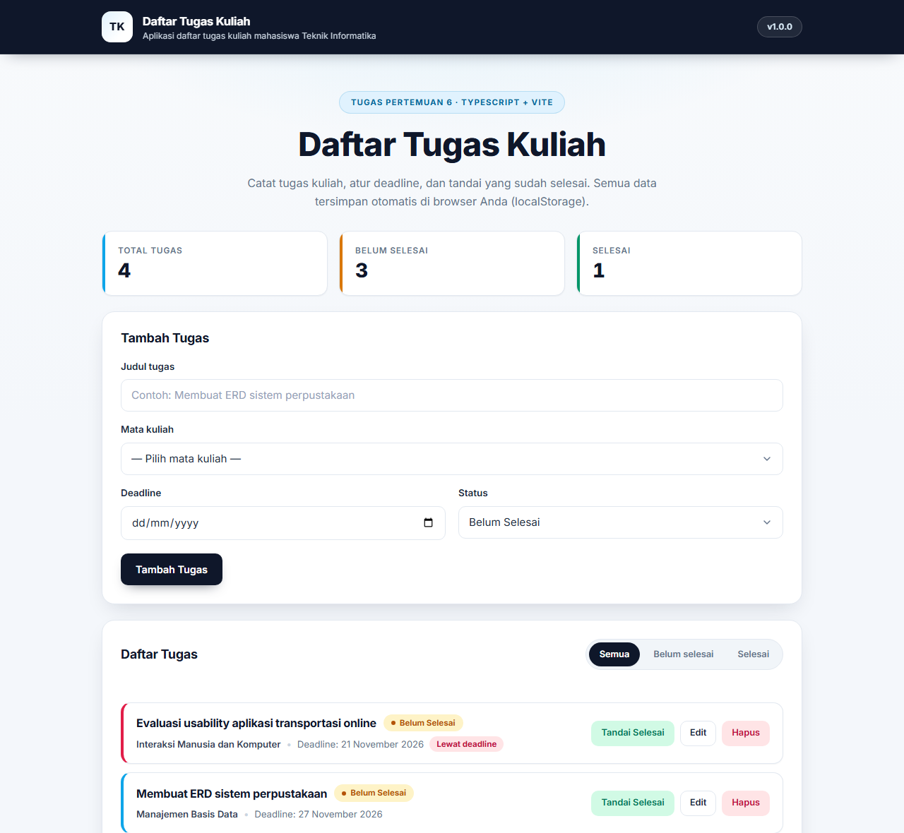

# Daftar Tugas Kuliah

Aplikasi pencatat tugas kuliah berbasis **TypeScript + Vite** tanpa framework. Data tersimpan di
`localStorage` browser, tema navy senada dengan [website portofolio](https://portofolio-gilang-iota.vercel.app/),
dan tampilan responsif dari desktop sampai layar 360px.

Dibuat untuk **Tugas Pertemuan 6 — Pengembangan Aplikasi Web**, Teknik Informatika,
UIN Sunan Gunung Djati Bandung.

- **Demo:** https://daftar-tugas-kuliah-gg.vercel.app/
- **Repository:** https://github.com/gggilangrizkyyy/portofolio-gilang
- **Folder ini:** `daftar-tugas-kuliah/`



---

## Fitur

- **Tambah tugas** — judul, mata kuliah (dropdown 7 mata kuliah semester 5), deadline, dan status.
- **Edit tugas** — data lama dimuat ke form; tombol berubah menjadi “Simpan Perubahan” + “Batal Edit”.
- **Hapus tugas** — memakai dialog konfirmasi agar tidak terhapus karena salah klik.
- **Ubah status** — tombol “Tandai Selesai” / “Tandai Belum” dengan badge berbeda warna
  (amber untuk belum selesai, hijau untuk selesai) dan judul tercoret saat selesai.
- **Filter** — Semua / Belum selesai / Selesai.
- **Statistik** — total tugas, belum selesai, dan selesai.
- **Deteksi deadline** — tugas yang lewat tenggat diberi garis merah dan label “Lewat deadline”.
- **Validasi form** — judul wajib (maks. 80 karakter), mata kuliah wajib dari daftar, deadline wajib.
- **Umpan balik** — pesan status dengan `aria-live`, error form di bawah judul panel.
- **Persisten** — data bertahan setelah halaman dimuat ulang (localStorage).
- **Responsif & aksesibel** — breakpoint 860/680/520/380px, focus ring, `prefers-reduced-motion`,
  dan gaya cetak (print).

---

## Teknologi

| Bagian | Dipakai |
|---|---|
| Bahasa | TypeScript 7 (`~7.0.2`) |
| Build tool | Vite 8 (`^8.3.6`, bundler **Rolldown**) |
| Styling | CSS murni (tanpa framework), font Inter |
| Penyimpanan | `localStorage` |
| Deploy | Vercel (static build) |

Tidak ada dependency runtime — `dependencies` kosong. Hanya `vite` dan `typescript` sebagai
`devDependencies`.

---

## Menjalankan secara lokal

**Prasyarat:** Node.js `^20.19.0` atau `>=22.12.0` (syarat Vite 8) dan npm.

```bash
git clone https://github.com/gggilangrizkyyy/portofolio-gilang.git
cd portofolio-gilang/daftar-tugas-kuliah
npm install
```

Buat file `.env` dari contoh (opsional — kode punya nilai fallback):

```bash
# macOS / Linux / Git Bash
cp .env.example .env
```

```powershell
# Windows PowerShell
Copy-Item .env.example .env
```

Jalankan server pengembangan:

```bash
npm run dev
```

Buka `http://localhost:5173/`.

---

## Script npm

| Perintah | Fungsi |
|---|---|
| `npm run dev` | Menjalankan Vite dev server + Hot Module Replacement (default port 5173) |
| `npm run build` | `tsc` memeriksa tipe (tanpa emit), lalu `vite build` menghasilkan `dist/` |
| `npm run preview` | Menjalankan hasil build dari `dist/` secara lokal (default port 4173) |

`tsc` di sini hanya **type-checking** karena `tsconfig.json` memakai `"noEmit": true`. Proses
transpile dan bundling dilakukan Vite/Rolldown.

---

## Environment variables

Semua variabel yang dipakai berawalan `VITE_` agar diteruskan Vite ke browser melalui
`import.meta.env`.

| Nama | Contoh nilai | Dipakai untuk |
|---|---|---|
| `VITE_APP_NAME` | `Daftar Tugas Kuliah` | Judul di header |
| `VITE_APP_VERSION` | `1.0.0` | Badge versi di header |
| `VITE_DESCRIPTION` | `Aplikasi daftar tugas kuliah mahasiswa Teknik Informatika` | Deskripsi di header & footer |

File `.env.example` hanya berisi contoh (boleh di-commit). File `.env` **tidak** di-commit karena
sudah ada di `.gitignore`.

> **Penting:** semua variabel `VITE_` ikut ter-bundle ke JavaScript dan bisa dibaca siapa pun lewat
> DevTools. Jangan pernah menaruh API key, token, atau password di sini. Data rahasia harus
> diproses di backend.

Saat deploy, nilainya diisi di **Vercel → Settings → Environment Variables**, bukan dari file
`.env` di repository.

---

## Struktur proyek

```text
daftar-tugas-kuliah/
├─ index.html            # kerangka halaman + entry <script type="module" src="/src/main.ts">
├─ src/
│  ├─ main.ts            # logika CRUD, render, validasi, filter, event delegation
│  ├─ types.ts           # TaskStatus, TaskFilter, Task, TaskFormData, TaskStats
│  ├─ courses.ts         # COURSES (7 mata kuliah) + tipe Course
│  ├─ storage.ts         # generic loadData<T>() dan saveData<T>()
│  ├─ style.css          # design token navy, komponen, breakpoint responsif
│  └─ vite-env.d.ts      # deklarasi tipe import.meta.env
├─ public/
│  └─ favicon.svg
├─ .env.example
├─ .gitignore
├─ package.json
├─ package-lock.json
└─ tsconfig.json
```

Folder `node_modules/`, `dist/`, dan `.env` tidak masuk repository.

---

## Materi TypeScript di proyek ini

Kode diberi penanda komentar agar mudah dicari saat presentasi:

| Penanda | Lokasi | Materi |
|---|---|---|
| `[TS-1]` | `src/types.ts` | Type alias + union (`TaskStatus`) |
| `[TS-1b]` | `src/types.ts` | Union untuk filter (`TaskFilter`) |
| `[TS-2]` | `src/types.ts` | `interface Task` |
| `[TS-2b]`, `[TS-2c]` | `src/types.ts` | `TaskFormData`, `TaskStats` |
| `[TS-3a]`–`[TS-3c]` | `src/types.ts` | Tipe primitif `string`, `number`, `boolean` |
| `[TS-4]` | `src/storage.ts` | Generic function `loadData<T>()`, `saveData<T>()` |
| `[TS-5]` | `src/main.ts` | Anotasi primitif pada konstanta |
| `[TS-6]` | `src/main.ts` | Array of interface (`Task[]`) |
| `[TS-7]` | `src/main.ts` | Fungsi dengan tipe parameter & return |
| `[TS-8]` | `src/courses.ts` | Indexed access type + `as const` |

Contoh inti:

```ts
export type TaskStatus = 'Belum Selesai' | 'Selesai';

export interface Task {
  id: string;
  title: string;
  course: string;
  deadline: string;
  status: TaskStatus;
  createdAt: string;
}

export function loadData<T>(key: string): T | null {
  try {
    const raw: string | null = localStorage.getItem(key);
    if (raw === null) {
      return null;
    }
    return JSON.parse(raw) as T;
  } catch (error) {
    console.warn(`[storage] gagal membaca "${key}":`, error);
    return null;
  }
}
```

---

## Cara kerja singkat

1. `init()` mengambil data dari `localStorage` dengan `loadData<Task[]>()`; kalau kosong dipakai `[]`.
2. `appShell()` merender kerangka halaman **sekali** (header, form, daftar, footer).
3. Semua aksi memakai **event delegation** pada `#app`, sehingga tombol hasil render ulang tetap
   berfungsi tanpa memasang listener satu per satu.
4. Setiap perubahan (`addTask`, `updateTask`, `deleteTask`, `toggleStatus`) memanggil `persist()`
   lalu `render()` — data dan tampilan selalu sinkron.
5. Data disimpan pada key `daftar-tugas-kuliah:tasks` dalam bentuk JSON.

Tugas diurutkan berdasarkan deadline terdekat. Nilai mata kuliah lama yang tidak ada di daftar
tetap bisa diedit lewat opsi sementara (`setCourseValue`), lalu opsi itu dibersihkan lagi.

---

## Riwayat pengerjaan (Git)

- Branch `feature/crud-tugas` — logika TypeScript & localStorage → **Pull Request #1**.
- Branch `feature/ui-responsive` — tema navy, font Inter, breakpoint responsif → **Pull Request #2**.
- Latihan **merge conflict** pada `latihan-konflik.txt` (dua branch mengubah baris yang sama),
  diselesaikan manual lalu di-commit dengan pesan `merge: resolve conflict ...`.
- Commit memakai format Conventional Commits: `feat:`, `style:`, `docs:`, `merge:`.

Lihat riwayat lengkap: https://github.com/gggilangrizkyyy/portofolio-gilang/commits/main

---

## Deploy ke Vercel

Karena aplikasi berada di dalam repository portofolio, buat **project Vercel terpisah**:

| Setelan | Nilai |
|---|---|
| Framework Preset | Vite |
| Root Directory | `daftar-tugas-kuliah` |
| Build Command | `npm run build` |
| Output Directory | `dist` |
| Install Command | `npm install` |

Tambahkan tiga environment variable `VITE_*` di dashboard, lalu **Deploy**. Setiap push ke
`main` akan memicu deploy otomatis. Hasil build ada di `dist/` (tidak di-commit).

---

## Catatan

- Data hanya tersimpan di browser masing-masing pengguna; tidak ada server atau database.
- Menghapus data situs di browser akan menghapus seluruh tugas yang tersimpan.
- Aplikasi memakai fitur browser modern (ES2023, `import.meta.env`, `localStorage`).

---

Dibuat oleh **Gilang Rizky Ramadhan** — mahasiswa Teknik Informatika, UIN Sunan Gunung Djati
Bandung.
